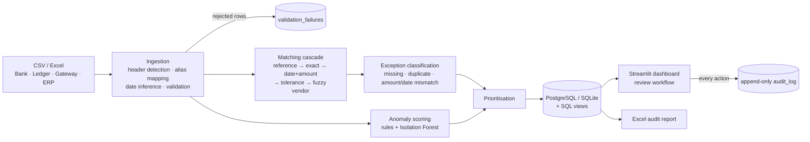

# Automated Financial Reconciliation & Anomaly Detection Platform

Compares transactions across **bank statements, company ledgers, payment gateways and ERP exports**
(CSV or Excel), reconciles them with a multi-stage matching cascade, surfaces missing / duplicate / mismatched
items, scores every transaction for anomalies, and gives reviewers a prioritised workflow with a tamper-evident
audit trail.

> **Read [`STATUS.md`](STATUS.md) first** for what is finished, what is measured, and the one significant open
> problem (auto-match precision).

Stack: Python · Pandas · scikit-learn · SQL · PostgreSQL (or SQLite) · Streamlit

## Quick start
```bash
pip install -r requirements-dev.txt
make data         # 3,000 simulated transactions; Bank and ERP written as Excel
make run          # ingest → match → classify → score → persist
make dashboard    # streamlit run dashboard.py
make test         # 166 tests
make eval         # grade the pipeline against the simulator's held-out labels
```
`data/` already contains a generated sample and a populated SQLite database, so `streamlit run dashboard.py`
works immediately. For PostgreSQL set `DATABASE_URL` (see `.env.example`); `TEST_DATABASE_URL` runs the whole test
suite against it too.

## Architecture


## What's in the box
| Area | Where |
|---|---|
| Ingestion & validation | `recon/ingestion.py` |
| Matching cascade | `recon/matching.py` |
| Exception classification | `recon/classification.py` |
| Anomaly detection | `recon/anomaly.py` |
| Review prioritisation | `recon/prioritization.py` |
| Workflow, audit log, queries | `recon/repository.py`, `recon/db.py` |
| SQL | `db/schema.sql` (DDL), `db/analytics.sql` (views) |
| Audit report | `recon/reports.py` |
| Simulator + ground-truth evaluation | `recon/simulate.py`, `recon/evaluation.py` |
| Dashboard | `dashboard.py` |

## Design notes worth knowing
- **Nothing is silently coerced.** v1 turned unparseable amounts into 0; v2 quarantines the row and records why.
- **Audit integrity is enforced by the database**: `audit_log` triggers reject UPDATE/DELETE; audit rows are
  written in the same transaction as the change they record.
- **Workflow rules live below the UI** (repository layer + CHECK constraints), so the dashboard can't bypass them.
- **Evidence should scale with coincidence risk** — the principle behind the planned matching fix (see STATUS).
- Anomaly model is **unsupervised** and never sees labels; evaluation is against simulated patterns only.

## Honest limitations
Quality numbers come from simulated data. Auto-matching currently pairs the wrong transactions about 1 time in 12
at 50k-row scale (details and fix plan in `STATUS.md`). Reviewer identity is a free-text name, not authentication.
